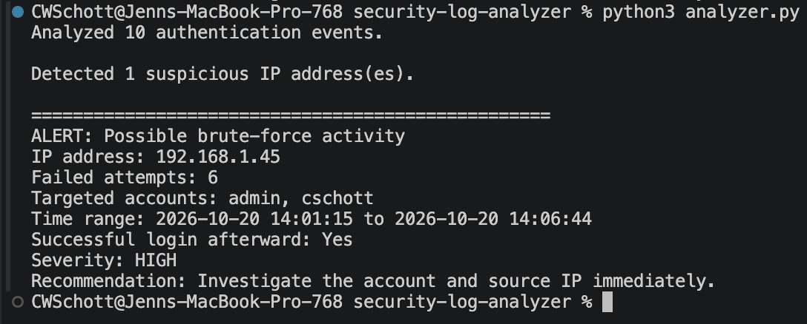

# Security Log Analyzer

A Python program that analyzes authentication logs and identifies
potential brute-force login activity.

## Features

- Parses authentication events from a text log
- Groups failed login attempts by IP address
- Identifies targeted user accounts
- Flags addresses that exceed a configurable failure threshold
- Detects successful logins following repeated failures
- Provides severity levels and response recommendations

## Detection Rule

An IP address is flagged after generating at least five failed login
attempts. A successful login following those failures raises the
alert severity to HIGH.

## How to Run

1. Install Python 3.
2. Clone or download this repository.
3. Open the project directory.
4. Run:

```bash
python3 analyzer.py
```

## Screenshot

